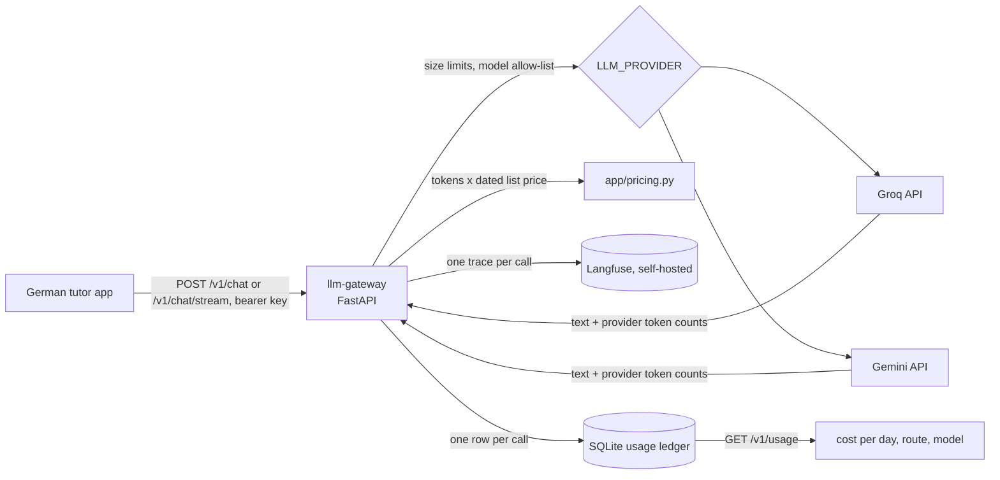

# llm-gateway

An async FastAPI service that sits between an application and its LLM providers and traces every call
to a self-hosted Langfuse. Built to put real tracing, cost tracking, guardrails, prompt A/B tests and an
LLM judge in front of one live app (a German tutor) instead of a demo.

Status (2026-10-28): working and in use. Tracing and per-call cost are done, plus SSE streaming,
bearer auth, request limits and a SQLite usage ledger. 21 tests, CI on every push. The live German
tutor app calls it. Next on the roadmap: per-user budgets, guardrails, prompt A/B, LLM judge.

Tracing: `/health`, `POST /v1/chat` with Groq and Gemini providers, one Langfuse trace per call
(root span + generation) carrying the provider's own token counts, session, user and route tags.
Langfuse is provisioned headlessly from `.env` (`LANGFUSE_INIT_*`), so `docker compose up` yields a
working project with no clicking. Nothing here is estimated.

Module 2 (cost, 2026-10-22): every call is priced as provider-reported tokens x a dated list price
(`app/pricing.py`, source URL per entry; an unpriced model gets `null`, never a guess). The cost goes
into the Langfuse generation (`cost_details`), the response's `usage.cost_usd`, and a SQLite ledger
(`data/usage.sqlite`). On Groq's free tier the real bill is 0; the number is what the same traffic
costs on the paid tier.

| Endpoint | What it does |
|---|---|
| `POST /v1/chat` | One completion, JSON. `model`, `temperature`, `reasoning_effort` per request |
| `POST /v1/chat/stream` | SSE: `delta` events, then one `done` with usage + cost (or `error`) |
| `GET /v1/usage?days=7` | Calls, tokens, cost, cost per call and per session, by day/route/model |

Set `GATEWAY_API_KEY` before exposing it beyond localhost: every `/v1` call then needs
`Authorization: Bearer <key>` (`/health` stays open). The German tutor uses it with
`LLM_PROVIDER=gateway` and `GATEWAY_URL` (its `lib/llm/gateway.ts`).

## How a call flows



## Run

```bash
cp .env.example .env            # add GROQ_API_KEY (or GEMINI_API_KEY + LLM_PROVIDER=gemini)
# generate LANGFUSE_PUBLIC_KEY / LANGFUSE_SECRET_KEY (any pk-lf-... / sk-lf-... strings) and put the
# same values in LANGFUSE_INIT_PROJECT_PUBLIC_KEY / _SECRET_KEY plus an INIT user email + password:
# Langfuse creates org, project, keys and login on first start.
docker compose up -d            # Langfuse (web, worker, postgres, clickhouse, redis, minio) + gateway
curl -s localhost:8080/health   # {"status":"ok","provider":"groq","tracing":true}
curl -s localhost:8080/v1/chat -H 'content-type: application/json' \
  -d '{"messages":[{"role":"user","content":"Korrigiere: Ich habe gestern ins Kino gegangen."}],"session_id":"demo","user_id":"u-demo","route":"tutor.correct"}'
```

The response includes `trace_id`; open it in the Langfuse UI.

Local, no Docker:

```bash
pip install -r requirements-dev.txt
uvicorn app.main:app --reload --port 8080
pytest -q                        # fake provider, tracing off, no network
```

## Design rules

- Token counts and cost come only from the provider's usage fields. No `len(prompt) // 4`.
- With no Langfuse keys the gateway runs with a no-op tracer and returns `trace_id: null`, never a fake id.
- `user_id` is a hash the caller computes. Raw emails never reach the gateway.
- Every token is paid for, so the request itself is bounded: at most 200 messages of 32,000 characters
  each (422 beyond that), and a per-request `model` must be in `ALLOWED_MODELS` (400 otherwise).
- The bearer key is compared in constant time (`hmac.compare_digest`).
- The image runs as an unprivileged user and carries no test dependencies (`requirements-dev.txt`).

## Limitations

- **One provider per process.** `LLM_PROVIDER` picks Groq or Gemini at startup. If Groq is down, calls fail with 502 or 504. Nothing falls back to Gemini.
- **Retries are minimal.** The streaming path retries a Groq 429 once, and only when `retry-after` is 10 s or less. Plain `/v1/chat` doesn't retry at all.
- **Gemini doesn't really stream.** The Gemini provider waits for the full answer and sends it as one `delta` event.
- **Failed streams cost nothing in the ledger.** If the provider errors halfway through a stream, the tokens it already generated get no ledger row and no cost.
- **A stream without a usage block is priced at $0.** If the provider never sends usage, the call is recorded with 0 tokens and a cost of 0, not `null`, so `unpriced_calls` doesn't count it.
- **Costs are list prices, kept by hand.** `app/pricing.py` was last checked on 2026-10-22. On Groq's free tier the real bill is 0. The figure is what the same traffic would cost on the paid tier, and it goes stale when Groq changes prices.
- **One shared key, no per-user limits yet.** Every caller uses the same bearer key. The only limits are request size and the model allow-list. Per-user budgets are on the roadmap.
- **Single instance only.** The ledger is one SQLite file behind one connection and a lock. Two replicas would write two separate ledgers.
- **No latency numbers yet.** I haven't measured how much time the gateway adds per call.

## Roadmap

1. Tracing: session/user grouping, streaming spans
2. Cost: dated per-model pricing, per-request cost, daily rollups, per-user budget (429)
3. Guardrails: PII masking, injection screen, output schema and language checks, trips recorded as scores
4. A/B prompt variants from Langfuse prompt management, sticky split, report with confidence intervals
5. LLM-as-judge on a sample of live turns, rubric scores written back, kappa against hand labels
6. CI regression gate on a 50-case dataset
7. Wire the tutor (`lib/llm` http provider), then the multi-agent pipeline
